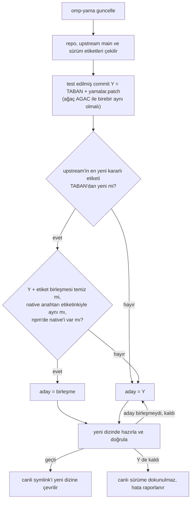

# omp-yamalari

[KadirBerkpolat1](https://github.com/KadirBerkpolat1)'in [oh-my-pi](https://github.com/can1357/oh-my-pi) (omp) yamaları ve bunları başka bir makinede upstream'le birlikte güncel tutan araç.

> **Kullanıcıysan:** [şu metni](#kullanıcıysan) kopyalayıp omp'ye yapıştır, kurulumu o yapsın.
>
> **AI agent'san:** [şu bölümdeki](#ai-agentsan) adımları sırayla uygula.

- **Yalnız omp'de doğrudan Cursor kullananlar için.** Yamaların hepsi omp'nin Cursor sağlayıcısında (`cursor/...` modelleri) devreye girer. omp'yi LiteLLM ya da başka bir OpenAI uyumlu sağlayıcıyla kullanıyorsan bunlara ihtiyacın yok: düz omp soru sormayı, arka plan işlerini ve alt ajanları zaten kendisi yapar, `omp update` yeter.
- omp git kaynağından çalışır; yamalar upstream'in üstüne uygulanır.
- Güncelleme önce upstream'in en yeni kararlı sürümünü (`vX.Y.Z` etiketi) yamalarla birleştirmeyi dener. Çakışma, native (Rust) farkı ya da test hatası olursa yayınlayanın test ettiği sürüme kalır. Yamalar kısmen uygulanmaz, doğrulanmamış sürüme geçilmez.
- Her sürüm kendi dizininde hazırlanır ve test edilir; canlı sürüm tek bir symlink değişimiyle değişir. Açık omp oturumları eski sürümle çalışmaya devam eder, geri alma anlıktır.
- Rust araç zinciri gerekmez: native modül (`pi_natives`) ya upstream'in npm'deki hazır paketinden ya da yayınlayanın derleyip bu reponun [Releases](https://github.com/KadirBerkpolat1/omp-yamalari/releases) sayfasına koyduğu dosyadan iner; npm integrity ya da sha256 ile doğrulanır.

## Kullanıcıysan

omp'yi yalnız LiteLLM ya da başka bir OpenAI uyumlu sağlayıcıyla kullanıyorsan buna gerek yok; düz omp yeter. omp'de doğrudan Cursor kullanıyorsan aşağıdaki metni kopyala ve omp'ye (ya da kullandığın başka bir AI agent'a) yapıştır:

```text
omp'yi KadirBerkpolat1'in yamalarıyla kurmanı istiyorum.
1. Şunu çalıştır: git clone https://github.com/KadirBerkpolat1/omp-yamalari ~/.local/share/omp-yamalari/repo
2. ~/.local/share/omp-yamalari/repo/README.md dosyasını oku ve "AI agent'san" bölümündeki adımları sırayla uygula.
```

Kurulum birkaç dakika sürer; agent bitti diyene kadar omp'yi kapatma. Bitince omp'yi kapatıp yeniden aç. Bundan sonra güncellemek için omp'ye "omp'yi güncelle" demen yeter. Kendin kurmak istersen: [Kurulum](#kurulum).

## AI agent'san

Kullanıcın omp'yi bu yamalarla kurmanı istediyse bu adımları sırayla uygula ve kullanıcıyla Türkçe konuş. Komutları kullanıcının hesabıyla çalıştır; `sudo` gerekirse kendin çalıştırma, komutu kullanıcıya ver.

0. **Yamalar işe yarar mı?** Yamalar yalnız omp'nin Cursor sağlayıcısında (`cursor/...` modelleri) devreye girer. Kullanıcı omp'yi LiteLLM ya da başka bir OpenAI uyumlu sağlayıcıyla kullanıyorsa (kendi modelinin sağlayıcısına bak; emin değilsen sor), kurmadan önce ona şunu söyle: "Bu yamalar yalnız doğrudan Cursor bağlantısında işe yarıyor; senin kurulumunda düz omp ile aynı davranacak. Yine de kurayım mı?" Kullanıcı isterse devam et.

   **Kurulum zaten var mı?** `~/.local/share/omp-yamalari/canli` varsa kurulum yapılmıştır: kurma; güncelleme, sürüm sorusu ve geri alma için `~/.local/share/omp-yamalari/repo/skill/omp-guncelle/SKILL.md` dosyasını oku ve uygula. Depo henüz yoksa klonla (zaten varsa `git clone` hata verir; sorun değil, devam et):
   ```sh
   git clone https://github.com/KadirBerkpolat1/omp-yamalari ~/.local/share/omp-yamalari/repo
   ```
1. **Ön koşulları denetle.** Biri eksikse kurmaya başlama; kullanıcıya ne yapması gerektiğini söyle.
   ```sh
   uname -sm                            # Linux x86_64 olmalı
   grep -E '^NATIVE_(KAYNAK|GLIBC)=' ~/.local/share/omp-yamalari/repo/yama.env
   getconf GNU_LIBC_VERSION             # NATIVE_KAYNAK=release ise en az NATIVE_GLIBC olmalı
   grep -m1 -ow avx2 /proc/cpuinfo      # NATIVE_KAYNAK=release ise "avx2" yazmalı
   command -v git curl zstd tar flock   # beşi de bulunmalı
   df -h ~/.local/share                 # en az 3 GB boş olmalı
   ```
   - glibc eski ya da araç eksik: Arch/CachyOS'ta kullanıcı `sudo pacman -Syu` ve `sudo pacman -S --needed git curl zstd tar util-linux` çalıştırsın; başka dağıtımda paket yöneticisinin karşılığını öner.
   - avx2 yok: bu yayın o işlemcide çalışmaz; kullanıcı KadirBerkpolat1'e haber versin.
   - bun yoksa sorun değil: `kur` onu `~/.bun`'a kurar ve kabuğun ayar dosyasına PATH satırı ekler; bunu kullanıcıya söyle.
2. **Kullanıcıya söyle:** "Kurulum birkaç dakika sürecek; ben bitti diyene kadar omp'yi kapatma."
3. **Kur.** Komuta uzun bir zaman aşımı ver (omp'de bash `timeout: 3600`):
   ```sh
   ~/.local/share/omp-yamalari/repo/omp-yama kur
   ```
   - Araç komutu arka plana alırsa sonucu bekle; ikinci bir `omp-yama` başlatma (çıkış kodu 3: önceki iş sürüyor).
   - "omp zaten başka bir git kaynağından çalışıyor" derse dur ve kullanıcıya sor. `--zorla`'yı yalnız kullanıcı açıkça onaylarsa kullan; o makine yamaların kaynağı olabilir.
4. **Sonucu oku:** çıktının sonundaki `UYARI=`, `SONUC=`, `YENI=`, `NEDEN=` ve `GUNLUK=` satırları.
   - `SONUC=guncellendi`: kurulum tamam. `UYARI=` satırlarını (PATH komutları, bun kurulumu) kullanıcıya aynen ilet.
   - `SONUC=basarisiz`: hiçbir şey değişmedi. `NEDEN`'i, gerekirse `GUNLUK` dosyasının son satırlarını oku; bilinen nedenler ve çözümleri `skill/omp-guncelle/SKILL.md` dosyasının "Başarısız olursa" bölümünde. Çözülemiyorsa kullanıcı `GUNLUK` dosyasını KadirBerkpolat1'e göndersin.
5. **Dene:** `~/.local/share/omp-yamalari/bin/omp --version` çıktısı `omp/<YENI'deki sürüm>` olmalı.
6. **Kullanıcıya söyle:** "Kurulum bitti (omp <sürüm>). omp'yi şimdi kapatıp yeniden aç; bu oturum hâlâ eski sürümle çalışıyor. Bundan sonra güncellemek için bana 'omp'yi güncelle' demen yeter."

omp dışında bir agent'san (Claude Code, Cursor, Codex gibi) `omp-guncelle` skill'i sende kendiliğinden yüklenmez; kullanıcı omp'yi güncellemeni istediğinde `skill/omp-guncelle/SKILL.md` dosyasını oku ve uygula.

**Asla:** `omp update`, @oh-my-pi paketleri için `bun install -g` / `bun update -g`, `npm i -g` ya da omp'nin resmî kurulum betiği (hepsi yamasız omp kurar); `~/.local/share/omp-yamalari` altında elle dosya düzenleme; yama çakışmasını elle çözme.

## Kurulum

Gerekenler: Linux x86_64, `git` 2.38+, `curl`, `zstd`, `tar`, `flock` (util-linux), `bun` 1.4.4+, en az 3 GB boş alan. bun yoksa resmî kurulum betiğiyle `~/.bun` içine kurulur; o betik kabuğun ayar dosyasına (`~/.bashrc`, `~/.zshrc` ya da fish ayarı) PATH satırı ekler ve `kaldir` bunu geri almaz. Releases'tan gelen native, yayınlayanın glibc sürümünü (bkz. aşağıdaki "Yamalar" bölümü) ve x86-64-v3 (AVX2) işlemci ister; sistem eskiyse önce `sudo pacman -Syu`.

```sh
git clone https://github.com/KadirBerkpolat1/omp-yamalari ~/.local/share/omp-yamalari/repo
~/.local/share/omp-yamalari/repo/omp-yama kur
```

`kur`:

- upstream'i `~/.local/share/omp-yamalari/kaynak.git` içine kısmi klonlar ve ilk sürümü hazırlayıp test eder;
- `omp` komutunu yamalı sürüme yönlendirir; yerine geçtiği eski `omp` dosyası `~/.local/share/omp-yamalari/yedek/` altına taşınır;
- omp'ye `omp-guncelle` skill'ini ekler (`~/.omp/agent/skills/omp-guncelle`).

Bitince omp'yi kapatıp yeniden aç.

## Kullanım

omp'ye "omp'yi güncelle" demen yeter; `omp-guncelle` skill'i aşağıdaki komutları çalıştırır. Güncelleme birkaç dakika sürer; sonuç gelene kadar omp'yi kapatma, bitince kapatıp yeniden aç.

| Komut | Ne yapar |
|---|---|
| `omp-yama kontrol` | Canlı sürümü, son yayını ve upstream'i karşılaştırır (`DURUM=guncel`, `guncelleme-var` ya da `upstream-yeni`); hiçbir şeyi değiştirmez |
| `omp-yama guncelle` | Upstream'in en yeni kararlı sürümü + yamaları dener, olmazsa test edilmiş sürüme geçer; zaten bu yayının en yeni sürümündeysen orada kalır |
| `omp-yama guncelle --test-edilmis` | Upstream'i denemeden test edilmiş sürüme geçer; geri alınmış olsa bile yeniden kurar |
| `omp-yama geri-al` | Bir önceki sürüme döner; bırakılan sürüm bir daha kendiliğinden kurulmaz |
| `omp-yama kaldir` | Eski `omp`'yi ve skill'i geri koyar, `~/.local/share/omp-yamalari`'yı siler; önce omp'yi kapat |

Komutun tam yolu `~/.local/share/omp-yamalari/repo/omp-yama`.

`omp update`, `bun install -g` / `bun update -g` ya da omp'nin resmî kurulum betiği yamalı omp'yi yamasız sürümle değiştirir; bunları kullanma. Böyle bir şey olduysa `omp-yama guncelle` `omp` komutunu yeniden yamalı sürüme bağlar.

## Nasıl çalışır



- `yama.env`: son yayının bilgileri (`TABAN` upstream commit'i, `AGAC` test edilmiş ağaç, `SURUM`, native kaynağı ve doğrulama değerleri).
- `yamalar.patch`: `TABAN` ile test edilmiş ağaç arasındaki fark. `TABAN`'a uygulanınca `AGAC`'ın birebir aynısı çıkar; `omp-yama` bunu her güncellemede denetler. Y'nin kimliği ve tarihi sabittir, her makinede aynı commit çıkar.
- Doğrulama: native gerçekten yükleniyor mu, `omp --version` doğru mu, yamanın dokunduğu test dosyaları geçiyor mu. En yeni sürüm adayında ayrıca yamanın dokunduğu paketlerde `bun run check:types` çalışır. Doğrulamadan geçemeyen en yeni sürüm adayı ve `geri-al` ile bırakılan sürüm `reddedilen` listesine girer, bir daha kendiliğinden kurulmaz; ağ ya da disk gibi ortam hataları sonraki güncellemede yeniden denenir.
- `ortak.sh`: iki tarafın paylaştığı sözleşme (yama üretimi, native anahtarı, sabit commit).

## Yamalar

- **Cursor AskQuestion köprüsü:** Cursor modelinin yerel AskQuestion aracı omp'nin `ask` formuyla cevaplanır.
- **Cursor canlı yönlendirme:** tur sürerken yazılan mesajlar ve biten arka plan işleri çalışan tura gider (`providers.cursorLiveSteering`, varsayılan kapalı).
- **Cursor yerel Task:** Cursor'ın Task aracı omp alt ajanlarında çalışır ([#18736](https://github.com/can1357/oh-my-pi/pull/18736)).
- **Cursor videoReview:** ekli videolar Gemini'ye izletilir ([#18741](https://github.com/can1357/oh-my-pi/pull/18741)).
- **Cursor model listesi:** AvailableModels listesi GetUsableModels kapısı olmadan gösterilir; veri saklama isteyen modeller de listelenir.

<!-- yamalar:basla -->
Son yayın: omp **18.18.6**, 2026-11-10T18:38:18Z · upstream tabanı [`1379127c078f`](https://github.com/can1357/oh-my-pi/commit/1379127c078f978c9908059d31f6dc6c16efbe53) · native: Releases [`native-8d0d308d1445`](https://github.com/KadirBerkpolat1/omp-yamalari/releases/tag/native-8d0d308d1445), `glibc >= 2.44`, x86-64-v3

40 dosya değişti: 2701 satır eklendi, 159 satır silindi.

<details>
<summary>Değişen dosyalar (40)</summary>

```text
 docs/settings.md                                                |   1 +
 docs/tools/ask.md                                               |   2 +-
 packages/agent/CHANGELOG.md                                     |   4 +
 packages/agent/src/agent-loop.ts                                |  39 ++++-
 packages/agent/src/live-steering.ts                             |  46 ++++--
 packages/agent/test/live-steering.test.ts                       |  95 +++++++++++-
 packages/ai/CHANGELOG.md                                        |   7 +
 packages/ai/src/providers/cursor.ts                             | 363 ++++++++++++++++++++++++++++++++++++++++++----
 packages/ai/src/providers/cursor/interaction-query.ts           | 125 ++++++++++++++--
 packages/ai/src/providers/cursor/live-steering.ts               | 112 ++++++++++++++
 packages/ai/src/providers/cursor/proto/agent.proto              |  23 +++
 packages/ai/src/stream.ts                                       |   1 +
 packages/ai/src/types.ts                                        | 127 +++++++++++++++-
 packages/ai/src/utils/glyph-codec.ts                            |  20 ++-
 packages/ai/test/cursor-exec-handlers.test.ts                   |  87 ++++++++++-
 packages/ai/test/cursor-exec-modern.test.ts                     | 161 +++++++++++++++++++-
 packages/ai/test/cursor-interaction-query.test.ts               | 379 +++++++++++++++++++++++++++++++++++++++++++++++-
 packages/ai/test/cursor-live-steering.test.ts                   | 130 +++++++++++++++++
 packages/ai/test/cursor-terminal-error.test.ts                  | 141 ++++++++++++++++++
 packages/ai/test/glyph-codec.test.ts                            |  73 +++++++++-
 packages/catalog/CHANGELOG.md                                   |   9 ++
 packages/catalog/scripts/proto-parser.ts                        |  12 +-
 packages/catalog/src/discovery/cursor-proto.ts                  |  50 +++++++
 packages/catalog/src/discovery/cursor.ts                        |  24 +--
 packages/catalog/src/provider-models/cache-provider-id.ts       |   4 +-
 packages/catalog/test/cursor-discovery.test.ts                  |  89 ++++++++++--
 packages/coding-agent/CHANGELOG.md                              |   5 +
 packages/coding-agent/src/cursor.ts                             | 246 ++++++++++++++++++++++++++++++-
 packages/coding-agent/src/prompts/system/cursor-video-review.md |   3 +
 packages/coding-agent/src/sdk.ts                                |  43 ++++--
 packages/coding-agent/src/session/settings-stream-fn.ts         |   9 +-
 packages/coding-agent/src/session/settings.ts                   |  13 ++
 packages/coding-agent/src/tools/ask.ts                          |   2 +-
 packages/coding-agent/test/cursor-exec.test.ts                  | 334 +++++++++++++++++++++++++++++++++++++++++-
 packages/coding-agent/test/tools/ask.test.ts                    |   1 +
 packages/tui/CHANGELOG.md                                       |   4 +
 packages/tui/src/render/render-utils.ts                         |  34 +----
 packages/tui/src/tools/ask.ts                                   |   4 +-
 packages/utils/CHANGELOG.md                                     |   4 +
 packages/utils/src/sanitize-text.ts                             |  34 +++++
```

</details>

<details>
<summary>Yama commit'leri (23)</summary>

| Commit | Konu |
|---|---|
| `afcb5c9c25c9` | fix(cursor): answer native AskQuestion with the ask dialog |
| `a8cb5243c14e` | fix(cursor): queue MCP ask calls with native questions |
| `3fea1be01ac8` | fix(cursor): reject native AskQuestion with the host-rewritten result |
| `0086cbcb12e6` | fix(cursor): cancel open questions when the transport fails |
| `7b940639eb9f` | fix(ai): keep private-field Cursor handlers callable through the glyph codec |
| `05f10b9f76e2` | fix(cursor): settle native questions on abort, stream end and host rewrites |
| `e6d50142043d` | refactor(cursor): simplify the native question cancellation paths |
| `0f24702f5e73` | docs(changelog): place the AskQuestion entries in their Unreleased sections |
| `77e9b1a31d32` | fix(ai): pass native AskQuestion through the glyph codec |
| `9b73f4ef39d0` | docs(changelog): keep the AskQuestion entries in Unreleased after the main merge |
| `bd4ec641efdb` | fix(ai): encode reserved ask labels at the glyph boundary |
| `b4e0bf241166` | fix(cursor): list AvailableModels roster without GetUsableModels gate |
| `4c74c2fa3bf0` | docs(catalog): changelog for Cursor AvailableModels roster fix |
| `85a274ae09ff` | feat(cursor): run native Task on omp subagents |
| `46e67f6c0381` | fix(cursor): list models Cursor flags as requiring data retention |
| `c9060ec929ab` | fix(cursor): cap Shell's 24 h hard_timeout at the bash ceiling |
| `bd79f54418d1` | feat(cursor): steer queued input and job results into running turns |
| `e09ec4e47453` | fix(cursor): keep exec frames in tool-batch order and land native edits as one diff card |
| `5c7dc3c45f99` | refactor(cursor): narrow exec frame ids and write details without casts |
| `00c1746915f3` | refactor(cursor): match the upstream PR versions of exec order and edit cards |
| `1597daaf16f5` | feat(cursor): run Cursor's videoReview subagent on Gemini with the attached videos |
| `2e307a76d802` | test(cursor): name the subagent call type in the videoReview test |
| `8a2f00f7349e` | refactor(cursor): run videoReview from a module function the glyph codec Proxy can call |

</details>
<!-- yamalar:bitis -->

## Yayınlayan için

Yamalar yayınlayanın `~/Projeler/oh-my-pi` deposundaki canlı daldan gelir. O dal upstream'le birleştirilip canlıda doğrulandıktan sonra:

```sh
./yayinla.sh --kuru   # dosyaları üretir ve denetler; commit, push ve yükleme yapmaz
./yayinla.sh          # yamalar.patch, yama.env ve bu sayfayı günceller, native'i Releases'a yükler, push eder
```

`yayinla.sh` yamanın eklenen ve başlık satırlarını ve README bloğunu ev dizini yolları, token ve anahtar biçimleri için tarar; eşleşme varsa yayın durur. Yayınlayana özel desenler repoya değil `~/.config/omp-yamalari/gizli-desenler` dosyasına yazılır; meşru bir satır `~/.config/omp-yamalari/izinli-satirlar` ile onaylanır. npm ya da upstream etiketleri geçici olarak okunamazsa yayın durur, başka bir native'e sessizce geçmez.

Native için sırayla şunlara bakılır: anahtarı aynıysa önceki yayının native'i, anahtarı aynı olan bir upstream sürümünün npm paketi, aynı anahtarlı mevcut Releases dosyası. Hiçbiri yoksa native geçici bir worktree'de derlenir ve Releases'a yüklenir. Native anahtarı Rust derleme girdilerinin özetidir; sürüm atlatma satırlarını saymaz.

## Lisans

Yamalar upstream oh-my-pi gibi MIT lisanslıdır.
